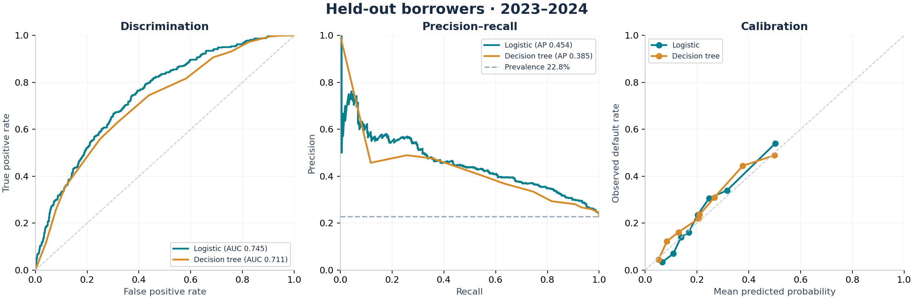
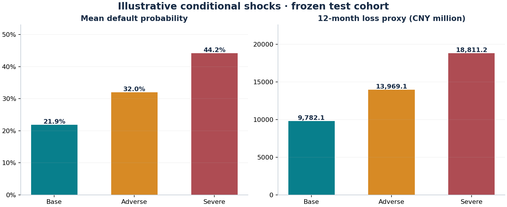

# Corporate Credit Risk Analytics

A reproducible work sample covering credit-risk modeling, statistical validation, scenario analysis and advanced Office reporting.

**Independent demonstration using entirely synthetic data.** No customer records, confidential models, employer documents or real lending decisions are included. The project illustrates a public, reproducible analytical workflow.



## Start here

| Review path | Artifact |
|---|---|
| Understand the analysis in a few minutes | [Credit risk memo — PDF](outputs/Credit_Risk_Memo.pdf) |
| Inspect formulas and change a scenario | [Excel credit review workbook](outputs/Credit_Risk_Review.xlsx) |
| See the presentation | [PowerPoint review deck](outputs/Credit_Risk_Review.pptx) |
| Walk through the calculations | [Rendered Jupyter notebook](notebooks/credit_risk_walkthrough.ipynb) |
| Read the core implementation | [Python pipeline](src/pipeline.py), [R implementation](r/credit_risk.R), [SAS implementation](sas/credit_risk.sas) |
| Upload this project or run it on Windows | [中文上传与运行指南](docs/GITHUB_UPLOAD_ZH.md) |

GitHub renders this README, the notebook and source files. Download the Excel, Word and PowerPoint files to inspect them in their native applications.

## What this demonstrates

| Area | Concrete implementation |
|---|---|
| Econometrics | Multivariable binary-logit MLE, odds ratios, HC1 robust Wald intervals, statistical significance, VIF diagnostics and a documented predictive interpretation. |
| Statistics | Time-based holdouts, outcome-maturity embargoes, validation-only model/threshold selection, ROC-AUC, average precision, Brier score, calibration curves and confusion matrices. |
| Credit analysis | Borrower financial ratios, prior delinquency, simulated macro conditions, risk segmentation and explicit conditional stress scenarios. |
| Excel | Row-level logistic scoring, editable assumptions, reconciliation, segmented summaries, charts and formula-driven loss proxies. |
| Office automation | Importable Power Query M, DAX measures and VBA source, plus a Word memorandum and PowerPoint deck. Native setup steps and execution limitations are documented. |
| Reproducibility | Seeded source generation, deterministic joins, duplicate/missing-data audit, reusable Python/R/SAS source and automated checks. |

## Data and evaluation design

The raw financial extract contains **6,401 rows**, including one intentional duplicate. After deduplication there are **6,400 unique synthetic borrowers**. Two deliberately incomplete records are excluded, leaving **6,398 complete records**. Each borrower appears once. The target is default within the following 12 months.

| Partition | Snapshot years | Complete records | Role |
|---|---|---:|---|
| Training | 2017–2019 | 2,400 | Estimate coefficients and fit candidate trees. |
| Maturity embargo | 2020 | 800 | Allow training outcomes to mature before validation. |
| Validation | 2021 | 800 | Select tree settings and classification thresholds. |
| Maturity embargo | 2022 | 800 | Allow validation outcomes to mature before the frozen test. |
| Test | 2023–2024 | 1,598 | Evaluate the locked models; all outcomes mature by December 2025. |

The logistic model uses five numeric predictors: debt/assets, debt-service coverage, borrowing interest rate, simulated GDP growth and a prior 30-day delinquency flag. Monetary fields are in **CNY million**. Interest rates and GDP growth are recorded in **percentage points**: `5.0` means 5%, not 500%.

## Results on the frozen test cohort

| Model | ROC-AUC | Average precision | Brier score ↓ | Threshold | Precision | Recall |
|---|---:|---:|---:|---:|---:|---:|
| Logistic regression | 0.745 | 0.454 | 0.1539 | 0.25 | 42.4% | 56.4% |
| Decision tree | 0.711 | 0.385 | 0.1594 | 0.21 | 37.0% | 63.0% |

Observed default prevalence is **22.84%** in this deliberately simulated cohort. It is not an estimate of any actual bank portfolio's default rate. The synthetic outcome generator contains a logistic relationship, so the benchmark favors the logistic specification by design. The results demonstrate the workflow, not real-world performance superiority.

The logistic classifier identifies **206** of **365** observed defaults at its validation-selected threshold, with **280** false positives. Thresholds maximize validation F1 over a declared grid; they do not encode a lending policy or a financial misclassification cost. Full train/validation/test tables are in [model_metrics.csv](outputs/model_metrics.csv).



## Scenario analysis

| Input or output | Base | Adverse | Severe |
|---|---:|---:|---:|
| Leverage adjustment | None | +0.05 | +0.10 |
| DSCR multiplier | 1.00× | 0.85× | 0.70× |
| Borrowing-rate shift | 0 pp | +1 pp | +2 pp |
| GDP-growth shift | 0 pp | −2 pp | −4 pp |
| Mean predicted default probability | 21.90% | 31.97% | 44.19% |
| 12-month loss proxy, CNY million | 9,782.1 | 13,969.1 | 18,811.2 |

These are conditional feature shocks applied to the same 1,598 borrowers with frozen coefficients. Leverage is clipped to [0, 1]. Exposure and prior delinquency remain fixed. The loss proxy is `sum(debt × predicted default probability × 45%)`: debt is an illustrative exposure proxy, and 45% is an assumed LGD. It is **not a complete IFRS 9 calculation or regulatory stress test**. The model does not estimate causal macroeconomic effects, loan repricing, amortization, collateral recovery or feedback between financial ratios.

The cohort combines borrowers observed at different snapshot dates; aggregate debt is not a loan-book balance at a single reporting date. GDP growth is outside the training range for 800 base-case records and all adverse/severe records. These scenarios therefore involve extrapolation; see [feature-support diagnostics](outputs/scenario_support.csv).

## Run the analysis

Use the Python version and package versions recorded in [run_environment.json](outputs/run_environment.json). In a fresh virtual environment:

```bash
python -m pip install -r requirements.txt
python -m src.pipeline
python -m unittest discover -s tests -v
```

The pipeline overwrites its generated synthetic CSV, JSON and chart outputs in this repository. It requires no credentials or external data. Office deliverables are prebuilt; their separate generation instructions are in [excel/README.md](excel/README.md) and [reports/README.md](reports/README.md).

For R, run the dependency-free base implementation with `Rscript r/credit_risk.R` from the repository root. See [R instructions](r/README.md), [SAS instructions](sas/README.md) and the [cross-tool comparison guide](docs/CROSS_TOOL_VALIDATION.md).

## Execution status

| Component | Status in this package |
|---|---|
| Python data generation, model fitting and evaluation | Executed; actual outputs committed. |
| Python checks | Executed; see [verification record](docs/VERIFICATION.md). |
| Excel formulas and charts | Recalculated and rendered with the workbook authoring engine; verification details recorded separately. |
| Word and PowerPoint | Generated from the committed analytic results and visually reviewed. |
| R and SAS implementations | Source supplied and reviewed. R/SAS runtimes were unavailable; cross-tool numerical agreement has not been verified. |
| Power Query, Power Pivot/DAX and VBA | Optional source modules supplied. Not embedded or executed in native Microsoft Excel. |

The `.xlsx` opens without enabling macros. Optional VBA is distributed as readable `.bas` source. See [Office extension setup](excel/OFFICE_EXTENSIONS.md) before importing any optional modules.

## Repository map

```text
data/         Synthetic source tables, prepared modeling data and field definitions
src/          Executable Python pipeline
r/            Base R implementation and numerical comparison utility
sas/          SAS implementation
excel/        Workbook builder and optional M / DAX / VBA modules
reports/      Word and presentation generation source
notebooks/    Executed calculation walkthrough for GitHub review
outputs/      Committed metrics, plots and Office deliverables
tests/        Numerical, reconciliation and leakage checks
docs/         Methodology, execution record, references and upload guide
```

Read the [methodology](docs/METHODOLOGY.md) for the data-generating process, uncertainty assumptions and model limitations. Read the [data dictionary](data/README.md) to trace field definitions and lineage. Primary software references are listed in [REFERENCES.md](docs/REFERENCES.md).

Licensed under the [MIT License](LICENSE). All dataset values and borrower identifiers are synthetic.
